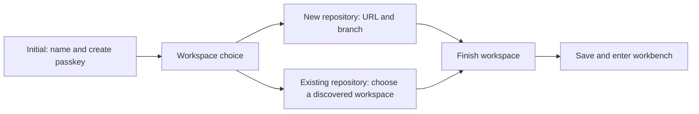

# Onboarding and Workspace Wireframes

These are the user's reference wireframes for onboarding and workspace setup.
The sketches establish screen sequence and information hierarchy; they are not
pixel specifications.

## Onboarding sequence

The finish screen summarizes the repository and branch, then collects the
workspace name, its generated slug, and an optional repository-relative path.
The new-repository Connect action checks access to the URL and branch before
continuing. Existing workspaces are presented as selectable repository/path
entries; a repository root is not selectable when it would reuse a repository.

## Workbench layouts

The second reference sheet shows the file-tree layout on desktop, the same
editor on mobile with a file-tree menu, and the tag-list layout. On mobile the
file tree is an overlay that can be opened and closed while keeping the editing
surface available. The bottom editor action bar and View/Settings controls stay
available in the shown layouts.

## Vim file-tree layout

The third sheet is a closer view of the desktop file-tree layout in Vim Insert
mode. It shows the repository path breadcrumb above the tree, parent (`.` and
`..`) navigation, selected-row treatment, the editor, bottom action bar, and
mode indicator. It is a detail view of the file-tree variant in the preceding
sheet, not a separate workspace flow.

## Source

The three sketches were supplied in the project conversation on 2026-10-17.
The original image attachments are not available as repository files, so this
document records their content and intent; add the original image files beside
this document and link them here when they are available as files.
